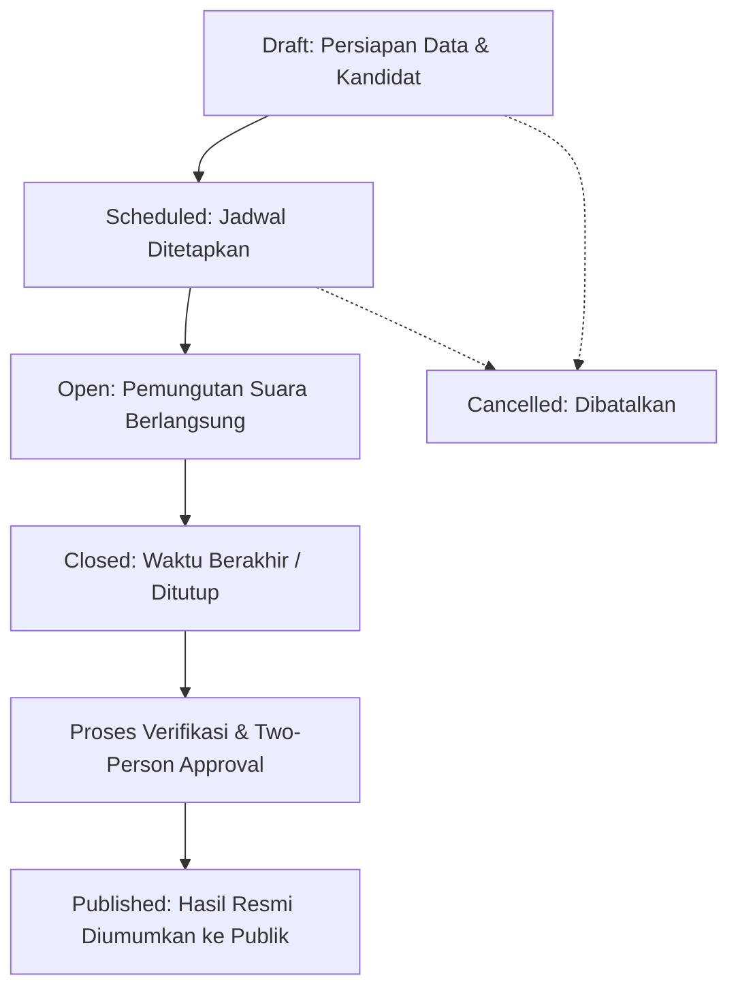

# E-Voting RT/RW - Sistem Digital Pemilihan Ketua RT & Ketua RW

[](https://laravel.com)
[](https://php.net)
[](https://mysql.com)
[](https://tailwindcss.com)
[](https://alpinejs.dev)
[](https://www.chartjs.org)
[-brightgreen?style=for-the-badge)](tests)

> **Sistem Pemilihan Digital Berbasis Web yang Aman, Terverifikasi Kriptografis, Rahasia (Secret Ballot), Adil (One Person One Vote), dan Ramah Lansia untuk Pemilihan Tingkat RT dan RW.**

---

## Daftar Isi
1. [Deskripsi Proyek](#deskripsi-proyek)
2. [Prinsip Desain & Fitur Utama](#prinsip-desain--fitur-utama)
3. [Teknologi yang Digunakan](#teknologi-yang-digunakan)
4. [Arsitektur Keamanan & Privasi Suara](#arsitektur-keamanan--privasi-suara)
5. [Prasyarat Sistem](#prasyarat-sistem)
6. [Panduan Instalasi Langkah Demi Langkah](#panduan-instalasi-langkah-demi-langkah)
7. [Konfigurasi Environment (.env)](#konfigurasi-environment-env)
8. [Akun Demo untuk Pengujian](#akun-demo-untuk-pengujian)
9. [Cara Menjalankan Aplikasi](#cara-menjalankan-aplikasi)
10. [Panduan Pengujian Otomatis](#panduan-pengujian-otomatis)
11. [Alur & Siklus Hidup Pemilihan](#alur--siklus-hidup-pemilihan)
12. [Struktur Role & Hak Akses (RBAC)](#struktur-role--hak-akses-rbac)
13. [Panduan Troubleshooting Umum](#panduan-troubleshooting-umum)
14. [Dokumentasi Lengkap Terkait](#dokumentasi-lengkap-terkait)

---

## Deskripsi Proyek

**E-Voting RT/RW** adalah aplikasi web modern kelas enterprise yang dirancang khusus untuk memodernisasi dan mendigitalisasi proses demokrasi di tingkat rukun tetangga (RT) dan rukun warga (RW). Menggantikan proses manual berbasis kertas yang rawan manipulasi, penghitungan lambat, dan biaya logistik tinggi, aplikasi ini memberikan jaminan matematis terhadap kerahasiaan pilihan warga sekaligus integritas hasil suara.

Aplikasi ini dibangun bukan sekadar sebagai prototipe visual, melainkan sistem fungsional penuh dengan proteksi *race condition*, audit trail berbasis *hash chaining* (kriptografis SHA-256), *two-person rule* untuk pengesahan hasil suara, pembatasan rate limit ketat, dan antarmuka yang sangat aksesibel bagi kalangan lanjut usia (*elderly-friendly UX*).

---

## Prinsip Desain & Fitur Utama

### 1. Jaminan Satu Pemilih Satu Suara (One Person, One Vote)
- Validasi status hak suara mutlak pada level database transaction dengan *pessimistic locking* (`FOR UPDATE`).
- Mekanisme **Single-Use Cryptographic Nonce Token** yang langsung kedaluwarsa setelah digunakan.
- Double click, refresh browser, atau pengiriman paket HTTP paralel tidak akan pernah menghasilkan suara ganda.
- Teruji dengan skrip pengujian konkurensi langsung di MySQL 8.4.

### 2. Kerahasiaan Suara Mutlak (Strict Secret Ballot Architecture)
- Tabel surat suara (`ballots`) **sama sekali tidak memiliki relasi atau foreign key** ke tabel pengguna (`users`), tabel warga (`residents`), maupun nomor identitas kependudukan (NIK).
- Bukti tanda terima pemilihan (`receipt_token`) yang diberikan kepada pemilih tidak dapat direkayasa balik untuk mengetahui kandidat yang dipilih.
- Log aktivitas sistem (Audit Log) mencatat bahwa pemilih telah menggunakan hak suaranya, namun **tidak pernah mencatat kandidat pilihannya**.

### 3. Perlindungan NIK & Data Pribadi Warga
- NIK tidak pernah disimpan dalam format teks polos (*plaintext*).
- Pencarian data warga menggunakan **HMAC-SHA256 Deterministic Hash Indexing** (`nik_hash`).
- Penyimpanan data NIK dan Nomor Kartu Keluarga menggunakan enkripsi AES-256-CBC (`nik_encrypted`, `no_kk_encrypted`).
- Tampilan NIK di layar secara otomatis disensor (*masked*) menjadi `3201**********12`.

### 4. Audit Trail Kriptografis (Tamper-Evident Hash Chaining)
- Setiap aksi sistem diikat dalam rantai hash kriptografis SHA-256:  
  `current_hash = SHA256(prev_hash | created_at | user_id | action | event_type | description | metadata)`
- Manipulasi langsung pada basis data akan merusak rantai hash dan segera terdeteksi oleh sistem audit integritas (`verifyChainIntegrity()`).
- Terdapat fitur verifikasi manual satu klik dan pembuatan *checkpoint* berkala.

### 5. Aturan Persetujuan Dua Pihak (Two-Person Rule Signoff)
- Hasil perolehan suara **tidak dapat dipublikasikan** ke publik sebelum disetujui secara digital oleh dua pihak independen: **Admin Wilayah** dan **Pengawas Independen**.
- Hasil imbang (*tie vote*) dideteksi secara otomatis dan mewajibkan Berita Acara Musyawarah Mufakat sebelum pengesahan.

### 6. Desain Ramah Lansia (Senior-Friendly UI/UX)
- Tipografi besar dengan kontras visual tinggi (sesuai standar WCAG AAA).
- Tombol pemungutan suara berukuran besar dengan kartu kandidat yang memuat foto jelas, nama, nomor urut, visi, dan misi.
- Dialog konfirmasi berlapis yang mencegah pemilih salah klik tanpa sengaja.
- Alur voting sederhana hanya dalam 3 langkah terarah: **Pilih Kandidat $\to$ Konfirmasi Pilihan $\to$ Simpan Tanda Terima**.

---

## Teknologi yang Digunakan

| Komponen | Teknologi | Keterangan |
|---|---|---|
| **Backend Framework** | Laravel 13.x | Framework PHP modern dengan arsitektur modular |
| **Bahasa Pemrograman** | PHP 8.4.x | Typed properties, match expressions, modern cryptography |
| **Basis Data** | MySQL 8.4 LTS | Strict mode, InnoDB ACID transactions, pessimistic row locks |
| **CSS Framework** | Tailwind CSS 4.x | Utilitas modern responsif |
| **Interaktivitas Frontend** | Alpine.js 3.x | Reaktivitas ringan tanpa overhead framework SPA berat |
| **Visualisasi Data** | Chart.js 4.x | Grafik interaktif hasil perolehan suara & partisipasi DPT |
| **Ekspor Dokumen** | DomPDF (`barryvdh/laravel-dompdf`) | Ekspor Berita Acara & Laporan Resmi Pemilihan dalam format PDF |
| **Pengujian Otomatis** | Pest / PHPUnit 11 | 26 unit & feature tests terintegrasi |

---

## Arsitektur Keamanan & Privasi Suara

Pemisahan data pemilih dan surat suara diatur melalui dua entitas independen:

```
[ Pemilih Terdaftar (DPT) ]
       │
       ▼
┌──────────────────────────────┐          ┌──────────────────────────────┐
│ election_eligible_voters     │          │ ballots                      │
├──────────────────────────────┤          ├──────────────────────────────┤
│ id                           │          │ id (UUID)                    │
│ election_id                  │          │ election_id                  │
│ resident_id                  │          │ candidate_id                 │
│ user_id                      │          │ cast_date (Hanya Tanggal)    │
│ has_voted (TRUE/FALSE)       │   X───X  │ ballot_hash (SHA-256)        │
│ voted_at (Waktu Voting)      │          │ is_valid (TRUE)              │
│ receipt_token (Tanda Terima) │          └──────────────────────────────┘
└──────────────────────────────┘           TIDAK ADA FK KE USER/RESIDENT!
```

- Ketika warga melakukan voting, sistem menjalankan transaksi basis data:
  1. Melakukan penguncian baris DPT dengan `lockForUpdate()`.
  2. Memverifikasi validitas token kriptografis sekali pakai (*single-use nonce*).
  3. Mengubah status DPT menjadi `has_voted = true`, mencatat waktu pemungutan suara, dan menghasilkan kode tanda terima anonim (`receipt_token`).
  4. Menghapus atau menandai token nonce sebagai hangus.
  5. Menuliskan surat suara ke tabel `ballots` secara independen dengan UUID unik dan hash kriptografis suara.
  6. Mencatat kejadian pemungutan suara pada Audit Log tanpa menyertakan pilihan kandidat.

---

## Prasyarat Sistem

Sebelum melakukan instalasi, pastikan lingkungan server lokal atau *hosting* Anda telah memenuhi spesifikasi berikut:

- **PHP**: Versi `^8.4` (ekstensi wajib: `pdo_mysql`, `openssl`, `mbstring`, `bcmath`, `curl`, `gd`, `zip`)
- **Composer**: Versi `^2.6`
- **MySQL**: Versi `8.4 LTS` atau `8.0+`
- **Node.js**: Versi `^20.0` atau `^24.0` dengan NPM `^10.0`
- **Git**: Versi `^2.40`

---

## Panduan Instalasi Langkah Demi Langkah

### 1. Klon Repositori
```bash
git clone <URL_REPOSITORI> e-voting
cd e-voting
```

### 2. Pasang Dependensi Backend (Composer)
```bash
composer install
```

### 3. Buat Berkas Konfigurasi Lingkungan (.env)
Salin berkas contoh `.env.example` menjadi `.env`:
```bash
cp .env.example .env
```
*(Pada Windows PowerShell gunakan `Copy-Item .env.example .env`)*

### 4. Generate Kunci Enkripsi Aplikasi
```bash
php artisan key:generate
```

### 5. Konfigurasi Basis Data
Buka berkas `.env` dan sesuaikan kredensial MySQL Anda:
```env
DB_CONNECTION=mysql
DB_HOST=127.0.0.1
DB_PORT=3306
DB_DATABASE=evoting_db
DB_USERNAME=root
DB_PASSWORD=
```
Pastikan database dengan nama `evoting_db` telah dibuat di MySQL server Anda:
```sql
CREATE DATABASE evoting_db CHARACTER SET utf8mb4 COLLATE utf8mb4_unicode_ci;
```

### 6. Jalankan Migrasi Basis Data & Seeder
Perintah berikut akan membuat seluruh tabel, hak akses, data wilayah, data penduduk contoh, akun pengguna, dan pemilihan simulasi:
```bash
php artisan migrate --seed
```

### 7. Buat Tautan Simbolik Storage (Storage Link)
Diperlukan untuk menampilkan foto kandidat dan aset publik:
```bash
php artisan storage:link
```

### 8. Pasang Dependensi Frontend & Kompilasi Aset
```bash
npm install
npm run build
```

---

## Konfigurasi Environment (.env)

Berikut parameter penting yang dapat disesuaikan pada berkas `.env`:

```env
APP_NAME="E-Voting RT/RW"
APP_ENV=local
APP_KEY=base64:...
APP_DEBUG=true
APP_URL=http://localhost:8000

# Pengaturan Basis Data MySQL 8.4 LTS
DB_CONNECTION=mysql
DB_HOST=127.0.0.1
DB_PORT=3306
DB_DATABASE=evoting_db
DB_USERNAME=root
DB_PASSWORD=

# Sesi & Keamanan Cookie
SESSION_DRIVER=database
SESSION_LIFETIME=120
SESSION_ENCRYPT=false
SESSION_PATH=/
SESSION_DOMAIN=null

# Cache & Queue
CACHE_STORE=database
QUEUE_CONNECTION=database
```

---

## Akun Demo untuk Pengujian

Database seeder telah menyediakan akun siap pakai untuk seluruh tingkatan pengguna:

| Role | Username | Password | Deskripsi Kewenangan |
|---|---|---|---|
| **Super Admin** | `superadmin` | `SuperAdmin123!` | Pengelolaan sistem penuh, kelola akun, wilayah RT/RW, audit log global, verifikasi integritas rantai hash |
| **Admin Wilayah** | `admin` | `Admin123!` | Kelola data warga & DPT, buat pemilihan, kelola kandidat, upload foto, persetujuan hasil (*approval*) |
| **Pengawas** | `pengawas` | `Pengawas123!` | Monitoring *real-time* suara, audit aktivitas admin, buat laporan pelanggaran, tanda tangan persetujuan hasil |
| **Pemilih 1** | `pemilih` | `Pemilih123!` | Warga RW 01 / RT 01 terdaftar DPT aktif (Siap melakukan voting pada Pemilihan Ketua RW 01) |
| **Pemilih 2** | `pemilih2` | `Pemilih123!` | Pemilih cadangan untuk pengujian multi-user |
| **Pemilih 3** | `pemilih3` | `Pemilih123!` | Pemilih cadangan untuk pengujian multi-user |
| **Pemilih 4** | `pemilih4` | `Pemilih123!` | Pemilih cadangan untuk pengujian multi-user |
| **Pemilih 5** | `pemilih5` | `Pemilih123!` | Pemilih cadangan untuk pengujian multi-user |

---

## Cara Menjalankan Aplikasi

Jalankan web server lokal Laravel:
```bash
php artisan serve
```
Aplikasi akan aktif dan dapat diakses melalui browser pada:
`http://localhost:8000`

Jika Anda ingin melakukan pengembangan antarmuka secara aktif dengan *hot-reloading* Vite:
```bash
npm run dev
```

---

## Panduan Pengujian Otomatis

Aplikasi dilengkapi dengan rangkaian pengujian otomatis (*automated test suite*) berbasis PHPUnit dan skrip simulasi serangan konkurensi di MySQL:

### 1. Menjalankan Seluruh Test Suite (PHPUnit)
```bash
php artisan test
```
*Hasil:* 26 skenario pengujian dengan 73 asersi keamanan yang memvalidasi autentikasi, otorisasi RBAC, integritas audit trail, two-person rule, dan pencegahan double-voting.

### 2. Menjalankan Pengujian Konkurensi & Keamanan Suara Nyata (Live MySQL)
Uji ketahanan sistem terhadap serangan *replay attack*, race condition klik cepat, dan pembuktian kerahasiaan *secret ballot* langsung pada engine MySQL 8.4:
```bash
php tests/mysql_concurrency_test.php
```

---

## Alur & Siklus Hidup Pemilihan

Siklus pemilihan diatur secara ketat melalui mesin status (*state machine*):



1. **Draft**: Admin mendaftarkan pemilihan, menetapkan cakupan wilayah (RT/RW), dan mendaftarkan kandidat.
2. **Scheduled**: Pemilihan dijadwalkan. Sinkronisasi DPT warga secara otomatis dijalankan berdasarkan cakupan wilayah.
3. **Open**: Pemilihan dibuka sesuai waktu mulai. Warga yang terdaftar dalam DPT dapat menggunakan hak suara. Profil pemilihan dan kandidat terkunci otomatis dari segala bentuk perubahan.
4. **Closed**: Pemilihan ditutup secara otomatis saat melewati batas waktu akhir atau ditutup manual oleh otoritas. Tidak ada lagi suara yang dapat masuk.
5. **Two-Person Approval**: Admin dan Pengawas memeriksa konsistensi jumlah pemilih versus surat suara. Keduanya menandatangani persetujuan secara digital.
6. **Published**: Hasil resmi dipublikasikan ke publik, grafik statistik terbuka, dan Berita Acara resmi dapat diunduh dalam format PDF.

---

## Struktur Role & Hak Akses (RBAC)

| Kemampuan / Fitur | Super Admin | Admin Wilayah | Pengawas | Pemilih |
|---|:---:|:---:|:---:|:---:|
| Mengelola Akun Petugas & Role | ✅ | ❌ | ❌ | ❌ |
| Mengelola Wilayah (Kelurahan, RW, RT) | ✅ | ❌ | ❌ | ❌ |
| Memeriksa Integritas Hash Audit Trail | ✅ | ❌ | ✅ | ❌ |
| Mengelola Pengaturan Global Sistem | ✅ | ❌ | ❌ | ❌ |
| Mengelola Data Warga & Import CSV | ❌ | ✅ | ❌ | ❌ |
| Membuat & Mengatur Pemilihan | ❌ | ✅ | ❌ | ❌ |
| Mendaftarkan Kandidat & Upload Foto | ❌ | ✅ | ❌ | ❌ |
| Memberikan Suara (*Vote*) | ❌ | ❌ | ❌ | ✅ |
| Melakukan Monitoring Suara Masuk | ✅ | ✅ | ✅ | ❌ |
| Mengirimkan Laporan Pelanggaran | ❌ | ❌ | ✅ | ❌ |
| Memberikan Persetujuan Hasil (*Signoff*) | ❌ | ✅ | ✅ | ❌ |
| Melihat Hasil Resmi Setelah Dipublikasi | ✅ | ✅ | ✅ | ✅ |
| Mengunduh Berita Acara Resmi (PDF) | ✅ | ✅ | ✅ | ❌ |

---

## Panduan Troubleshooting Umum

1. **Koneksi Database Gagal (`SQLSTATE[HY000] [2002] Connection refused`):**  
   Pastikan service MySQL telah aktif pada port 3306 dan kredensial di file `.env` sudah sesuai.
2. **Aset CSS/JS Tidak Tampil Rapi:**  
   Jalankan perintah `npm run build` untuk mengompilasi berkas Tailwind CSS dan Alpine.js ke folder `public/build`.
3. **Foto Kandidat Tidak Muncul:**  
   Pastikan symlink storage telah dibuat dengan menjalankan `php artisan storage:link`.
4. **Kesalahan Izin Akses Folder Storage (Linux/Production):**  
   Berikan izin tulis pada direktori storage:  
   `chmod -R 775 storage bootstrap/cache`
5. **Sesi Pengguna Cepat Berakhir:**  
   Sesuaikan `SESSION_LIFETIME` pada berkas `.env` (nilai default adalah 120 menit).

---

## Dokumentasi Lengkap Terkait

Untuk pemahaman teknis yang lebih mendalam, silakan merujuk pada dokumen arsitektur dan panduan pengguna di direktori `docs/`:

- [Arsitektur Sistem (docs/ARCHITECTURE.md)](docs/ARCHITECTURE.md)
- [Struktur Database & ERD (docs/DATABASE.md)](docs/DATABASE.md)
- [Arsitektur Keamanan & Kriptografi (docs/SECURITY.md)](docs/SECURITY.md)
- [Diagram Alur Pemungutan Suara (docs/VOTING-FLOW.md)](docs/VOTING-FLOW.md)
- [Buku Panduan Pengguna Lengkap (docs/USER-GUIDE.md)](docs/USER-GUIDE.md)
- [Panduan Deployment Server Produksi (docs/DEPLOYMENT.md)](docs/DEPLOYMENT.md)
- [Panduan Pengujian Otomatis (docs/TESTING.md)](docs/TESTING.md)

---

**Dikembangkan dengan dedikasi untuk transparansi demokrasi warga dan keamanan digital yang kokoh.**
