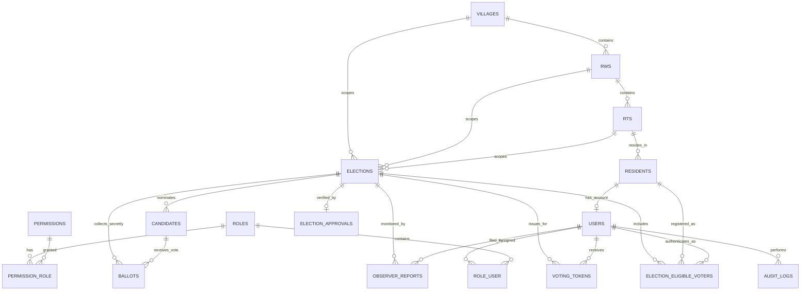

# Rancangan Basis Data & ERD (Entity Relationship Diagram)

Dokumen ini memuat dokumentasi skema basis data lengkap sistem **E-Voting RT/RW**, termasuk Entity Relationship Diagram (ERD), kamus data setiap tabel, strategi pengindeksan, serta proteksi kriptografis pada level data.

---

## 1. Diagram Relasi Entitas (Mermaid ERD)

> [!IMPORTANT]
> **Perhatikan Relasi Tabel `BALLOTS`:**  
> Tabel `ballots` secara ketat **HANYA** memiliki relasi ke `elections` dan `candidates`. **TIDAK ADA** relasi asing (*foreign key*) yang menghubungkan `ballots` ke `users` atau `residents`. Hal ini menjamin prinsip *Secret Ballot* (Kerahasiaan Pilihan) secara permanen pada level skema basis data.

---

## 2. Kamus Data & Struktur Tabel

### 2.1. Entitas Wilayah (`villages`, `rws`, `rts`)

#### Tabel `villages` (Kelurahan / Desa)
| Kolom | Tipe Data | Keterangan |
|---|---|---|
| `id` | BIGINT UNSIGNED (PK) | Auto increment identifier |
| `name` | VARCHAR(100) | Nama kelurahan/desa |
| `code` | VARCHAR(20) (Unique) | Kode wilayah administrasi |
| `district` | VARCHAR(100) | Nama kecamatan |
| `city` | VARCHAR(100) | Nama kota/kabupaten |
| `province` | VARCHAR(100) | Nama provinsi |

#### Tabel `rws` (Rukun Warga)
| Kolom | Tipe Data | Keterangan |
|---|---|---|
| `id` | BIGINT UNSIGNED (PK) | Auto increment identifier |
| `village_id` | BIGINT UNSIGNED (FK) | Relasi ke `villages.id` |
| `number` | VARCHAR(10) | Nomor RW (contoh: "01", "02") |
| `name` | VARCHAR(100) | Nama sebutan RW / Dusun |

#### Tabel `rts` (Rukun Tetangga)
| Kolom | Tipe Data | Keterangan |
|---|---|---|
| `id` | BIGINT UNSIGNED (PK) | Auto increment identifier |
| `rw_id` | BIGINT UNSIGNED (FK) | Relasi ke `rws.id` |
| `number` | VARCHAR(10) | Nomor RT (contoh: "01", "02") |
| `name` | VARCHAR(100) | Nama sebutan RT |

---

### 2.2. Entitas Kependudukan & Pengguna

#### Tabel `residents` (Data Warga)
| Kolom | Tipe Data | Keterangan |
|---|---|---|
| `id` | BIGINT UNSIGNED (PK) | Auto increment identifier |
| `rt_id` | BIGINT UNSIGNED (FK) | Relasi ke `rts.id` |
| `nik_hash` | VARCHAR(64) (Unique) | HMAC-SHA256 dari NIK untuk pencarian indeks deterministik |
| `nik_encrypted` | TEXT | NIK terenkripsi menggunakan AES-256-CBC |
| `nik_masked` | VARCHAR(20) | NIK disensor untuk antarmuka (`3201**********12`) |
| `name` | VARCHAR(150) | Nama lengkap warga sesuai KTP |
| `no_kk_encrypted` | TEXT (Nullable) | Nomor Kartu Keluarga terenkripsi AES-256-CBC |
| `birth_place` | VARCHAR(100) (Nullable) | Tempat lahir |
| `birth_date` | DATE (Nullable) | Tanggal lahir untuk perhitungan batas usia pemilih ($\ge 17$ tahun) |
| `gender` | ENUM('L', 'P') | Jenis kelamin |
| `address` | TEXT (Nullable) | Alamat lengkap domisili |
| `phone` | VARCHAR(20) (Nullable) | Nomor telepon/WhatsApp |
| `marital_status` | ENUM('single', 'married', 'widowed') | Status perkawinan |
| `status` | ENUM('active', 'moved', 'deceased') | Status domisili warga |
| `is_eligible_voter` | BOOLEAN (Default: true) | Flag kelayakan hak suara |

#### Tabel `users` (Akun Sistem)
| Kolom | Tipe Data | Keterangan |
|---|---|---|
| `id` | BIGINT UNSIGNED (PK) | Auto increment identifier |
| `resident_id` | BIGINT UNSIGNED (FK, Nullable) | Relasi satu-ke-satu ke data warga jika berupa voter |
| `name` | VARCHAR(255) | Nama pengguna |
| `username` | VARCHAR(50) (Unique) | Nama pengguna unik untuk otentikasi login |
| `email` | VARCHAR(255) (Nullable) | Alamat surel |
| `password` | VARCHAR(255) | Hash kata sandi menggunakan Bcrypt |
| `is_active` | BOOLEAN (Default: true) | Status keaktifan akun |
| `last_login_at` | DATETIME (Nullable) | Stempel waktu login terakhir |
| `last_login_ip` | VARCHAR(45) (Nullable) | Alamat IP login terakhir |

---

### 2.3. Entitas Hak Akses (RBAC)

- `roles`: Menyimpan daftar role (`superadmin`, `admin`, `pengawas`, `voter`).
- `permissions`: Menyimpan daftar izin spesifik (misal: `residents.manage`, `elections.create`).
- `role_user`: Tabel pivot relasi banyak-ke-banyak antara pengguna dan perannya.
- `permission_role`: Tabel pivot relasi banyak-ke-banyak antara peran dan izin hak akses.

---

### 2.4. Entitas Pemilihan & Kandidat

#### Tabel `elections` (Daftar Periode Pemilihan)
| Kolom | Tipe Data | Keterangan |
|---|---|---|
| `id` | BIGINT UNSIGNED (PK) | Auto increment identifier |
| `title` | VARCHAR(200) | Judul pemilihan (contoh: "Pemilihan Ketua RW 01 2026-2031") |
| `election_type` | ENUM('RT', 'RW') | Tingkat lingkup pemilihan |
| `village_id` | BIGINT UNSIGNED (FK) | Relasi wilayah desa/kelurahan |
| `rw_id` | BIGINT UNSIGNED (FK, Nullable) | Relasi wilayah RW |
| `rt_id` | BIGINT UNSIGNED (FK, Nullable) | Relasi wilayah RT (jika jenis pemilihan RT) |
| `period_start_year` | INT | Tahun mulai masa jabatan |
| `period_end_year` | INT | Tahun akhir masa jabatan |
| `start_time` | DATETIME | Waktu mulai pemungutan suara |
| `end_time` | DATETIME | Waktu berakhir pemungutan suara |
| `status` | ENUM | Status: `draft`, `scheduled`, `open`, `closed`, `published`, `cancelled` |
| `schedule_locked` | BOOLEAN (Default: false) | Kunci jadwal otomatis saat pemilihan dibuka |
| `schedule_locked_at` | DATETIME (Nullable) | Waktu penguncian jadwal |

#### Tabel `candidates` (Kandidat Calon Ketua)
| Kolom | Tipe Data | Keterangan |
|---|---|---|
| `id` | BIGINT UNSIGNED (PK) | Auto increment identifier |
| `election_id` | BIGINT UNSIGNED (FK) | Relasi ke pemilihan |
| `resident_id` | BIGINT UNSIGNED (FK, Nullable) | Relasi ke data warga (opsional) |
| `candidate_number` | INT | Nomor urut calon (unik per pemilihan) |
| `name` | VARCHAR(150) | Nama lengkap kandidat |
| `photo_path` | VARCHAR(255) (Nullable) | Lokasi berkas pas foto kandidat |
| `vision` | TEXT | Visi pencalonan |
| `mission` | TEXT | Misi pencalonan |
| `bio` | TEXT (Nullable) | Riwayat hidup singkat |
| `status` | ENUM('active', 'withdrawn') | Status keikutsertaan kandidat |

---

### 2.5. Entitas Pemungutan Suara (Voting)

#### Tabel `election_eligible_voters` (Daftar Pemilih Tetap - DPT)
| Kolom | Tipe Data | Keterangan |
|---|---|---|
| `id` | BIGINT UNSIGNED (PK) | Auto increment identifier |
| `election_id` | BIGINT UNSIGNED (FK) | Relasi ke pemilihan |
| `resident_id` | BIGINT UNSIGNED (FK) | Relasi ke identitas warga |
| `user_id` | BIGINT UNSIGNED (FK, Nullable) | Relasi ke akun pengguna |
| `has_voted` | BOOLEAN (Default: false) | Status penggunaan hak suara |
| `voted_at` | DATETIME (Nullable) | Waktu pemilih menggunakan hak suara |
| `receipt_token` | VARCHAR(100) (Nullable, Unique) | Kode tanda terima anonim untuk pemilih |

#### Tabel `ballots` (Kotak Suara Rahasia - SECRET BALLOT)
| Kolom | Tipe Data | Keterangan |
|---|---|---|
| `id` | CHAR(36) UUID (PK) | UUID acak untuk mencegah enumerasi ID berurutan |
| `election_id` | BIGINT UNSIGNED (FK) | Relasi ke pemilihan terkait |
| `candidate_id` | BIGINT UNSIGNED (FK) | Relasi ke kandidat yang dipilih |
| `cast_date` | DATE | Tanggal pemungutan suara (tanpa jam/menit/detik untuk anti korelasi waktu) |
| `ballot_hash` | VARCHAR(64) (Unique) | Hash kriptografis integritas surat suara |
| `is_valid` | BOOLEAN (Default: true) | Status validitas surat suara |

#### Tabel `voting_tokens` (Token Kriptografis Sekali Pakai - Nonce)
| Kolom | Tipe Data | Keterangan |
|---|---|---|
| `id` | BIGINT UNSIGNED (PK) | Auto increment identifier |
| `election_id` | BIGINT UNSIGNED (FK) | Relasi ke pemilihan |
| `user_id` | BIGINT UNSIGNED (FK) | Relasi ke akun pemilih |
| `token_hash` | VARCHAR(64) (Unique) | SHA-256 dari token acak |
| `expires_at` | DATETIME | Batas waktu kedaluwarsa token (15 menit) |
| `is_used` | BOOLEAN (Default: false) | Flag penggunaan token |
| `used_at` | DATETIME (Nullable) | Waktu penukaran token dengan surat suara |

---

### 2.6. Entitas Audit & Pengawasan

#### Tabel `audit_logs` (Jejak Audit Berantai Kriptografis)
| Kolom | Tipe Data | Keterangan |
|---|---|---|
| `id` | BIGINT UNSIGNED (PK) | Auto increment urutan rekaman |
| `user_id` | BIGINT UNSIGNED (FK, Nullable) | Pengguna pelaku aktivitas |
| `action` | VARCHAR(100) | Aksi (contoh: `cast_vote`, `create_election`, `login`) |
| `event_type` | VARCHAR(50) | Kategori event (`voting`, `security`, `election`, `user_management`) |
| `description` | TEXT | Narasi detail aktivitas |
| `ip_address` | VARCHAR(45) (Nullable) | Alamat IP pengguna |
| `user_agent` | VARCHAR(255) (Nullable) | User Agent browser |
| `metadata` | JSON (Nullable) | Data tambahan kontekstual |
| `previous_hash` | VARCHAR(64) | Nilai hash dari rekaman log sebelum record ini |
| `current_hash` | VARCHAR(64) (Unique) | Hash SHA-256 rekaman ini yang mengikat seluruh atribut |

#### Tabel `audit_checkpoints` (Titik Verifikasi Integritas)
| Kolom | Tipe Data | Keterangan |
|---|---|---|
| `id` | BIGINT UNSIGNED (PK) | Auto increment identifier |
| `last_audit_log_id` | BIGINT UNSIGNED (FK) | ID log terakhir saat verifikasi dijalankan |
| `checkpoint_hash` | VARCHAR(64) | Nilai hash pada log terakhir |
| `is_valid` | BOOLEAN | Status integritas rantai pada saat verifikasi |
| `verified_by_user_id` | BIGINT UNSIGNED (FK, Nullable) | Verifikator (Super Admin / Pengawas) |
| `notes` | TEXT (Nullable) | Catatan pemeriksaan berkala |

#### Tabel `election_approvals` (Two-Person Rule Signoff)
| Kolom | Tipe Data | Keterangan |
|---|---|---|
| `id` | BIGINT UNSIGNED (PK) | Auto increment identifier |
| `election_id` | BIGINT UNSIGNED (FK, Unique) | Relasi ke pemilihan terkait |
| `admin_approved` | BOOLEAN (Default: false) | Persetujuan oleh Admin Wilayah |
| `admin_user_id` | BIGINT UNSIGNED (FK, Nullable) | ID pengguna Admin yang menyetujui |
| `admin_approved_at` | DATETIME (Nullable) | Waktu tanda tangan Admin |
| `admin_notes` | TEXT (Nullable) | Catatan Admin mengenai pelaksanaan pemilihan |
| `supervisor_approved` | BOOLEAN (Default: false) | Persetujuan oleh Pengawas Independen |
| `supervisor_user_id` | BIGINT UNSIGNED (FK, Nullable) | ID pengguna Pengawas yang menyetujui |
| `supervisor_approved_at` | DATETIME (Nullable) | Waktu tanda tangan Pengawas |
| `supervisor_notes` | TEXT (Nullable) | Catatan pengawasan mengenai integritas suara |
| `is_fully_approved` | BOOLEAN (Default: false) | Bernilai true jika kedua pihak telah menyetujui |
| `tie_resolution_notes` | TEXT (Nullable) | Catatan Berita Acara musyawarah jika terjadi hasil seri (*tie vote*) |

---

## 3. Strategi Pengindeksan (Indexing)

Untuk memastikan performa tinggi dan pencegahan anomali duplikasi, indeks dibuat secara strategis:

1. **Composite Unique Indices**:
   - `election_eligible_voters`: `UNIQUE(election_id, resident_id)` menjamin 1 warga hanya terdaftar 1 kali per pemilihan.
   - `election_eligible_voters`: `UNIQUE(election_id, user_id)` menjamin 1 user login hanya terhubung ke 1 entri DPT.
   - `candidates`: `UNIQUE(election_id, candidate_number)` menjamin nomor urut tidak pernah bentrok.
2. **Lookup Indices**:
   - `residents`: `INDEX(nik_hash)` untuk pencarian instan $O(1)$ berdasarkan hash NIK.
   - `election_eligible_voters`: `INDEX(election_id, has_voted)` untuk query cepat jumlah partisipasi dan filter pemilih belum memilih.
   - `ballots`: `INDEX(election_id, candidate_id)` untuk optimasi agregasi penghitungan suara saat penutupan pemilihan.
   - `audit_logs`: `INDEX(event_type)`, `INDEX(created_at)` untuk audit trail querying.
