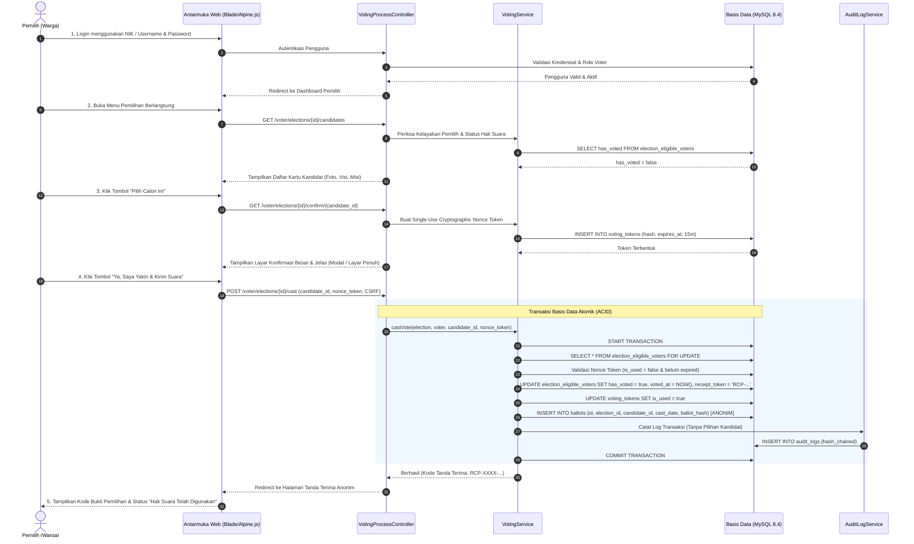

# Diagram Alur & Proses Pemungutan Suara (Voting Flow)

Dokumen ini menjelaskan alur operasional pemungutan suara digital dari sudut pandang pemilih (*voter experience*), arsitektur komunikasi sistem, dan diagram urutan teknis (*sequence diagram*).

---

## 1. Diagram Urutan Pemungutan Suara (Sequence Diagram)

---

## 2. Rincian 3 Langkah Sederhana untuk Warga (Senior-Friendly UX)

Sistem dirancang dengan filosofi kemudahan akses untuk semua kalangan, khususnya warga lanjut usia yang belum terbiasa dengan aplikasi digital rumit:

### Langkah 1: Membaca & Memilih Calon
- Setiap calon ketua RT/RW disajikan dalam bentuk **Kartu Besar** yang memuat:
  - Nomor urut berukuran ekstra besar di sudut atas.
  - Pas foto calon dengan resolusi jelas.
  - Nama lengkap dan gelar.
  - Ringkasan visi dan misi dalam teks terbaca jelas.
- Tombol aksi berwarna kontras tinggi: **"PILIH KANDIDAT INI"**.

### Langkah 2: Konfirmasi Pilihan Bertingkat
- Setelah tombol pilihan diklik, sistem tidak langsung mengirim suara, melainkan memunculkan layar konfirmasi dengan latar belakang redup (*focus mode*).
- Menampilkan foto dan nama calon yang dipilih dengan pertanyaan:  
  *"Apakah Anda yakin ingin memberikan suara Anda kepada [Nama Calon]?"*
- Terdapat dua tombol besar:
  - Hijau: **"YA, SAYA YAKIN DAN KIRIM SUARA"**
  - Abu-abu netral: **"KEMBALI DAN GANTI PILIHAN"**
- Hal ini mencegah kesalahan klik yang tidak disengaja.

### Langkah 3: Bukti Tanda Terima Anonim (Receipt Token)
- Setelah suara berhasil disimpan secara permanen di database, sistem menampilkan layar sukses:
  - Ikon centang hijau besar: **"Suara Anda Berhasil Dicatat!"**
  - Kode tanda terima pemilihan, contoh: `RCP-LEVCM6-30b7bad52988a7db680cb518cd...`
  - Tombol **"Cetak / Simpan Bukti Suara"** atau tombol **"Selesai & Keluar"**.
- Warga mendapatkan kepastian batin bahwa hak suaranya telah masuk, tanpa sedikit pun membocorkan calon yang dipilihnya ke publik atau panitia.

---

## 3. Penanganan Kondisi Pengecualian & Skenario Gagal

| Skenario | Tindakan Sistem | Pesan ke Pengguna |
|---|---|---|
| **Pemilih mencoba memilih kembali setelah selesai** | Sistem memeriksa `has_voted == true` pada layer Controller dan Service | Dialihkan ke dashboard dengan notifikasi: *"Anda sudah menggunakan hak suara Anda pada pemilihan ini."* |
| **Token kedaluwarsa (> 15 menit)** | Validasi token mendeteksi `expires_at < Carbon::now()` | *"Sesi pemilihan telah kedaluwarsa demi keamanan. Silakan pilih kembali kandidat Anda."* |
| **Pemilihan belum dibuka / telah ditutup** | Middleware dan Service memeriksa status `election.status != 'open'` atau waktu di luar jadwal | *"Pemungutan suara untuk pemilihan ini belum dibuka atau telah berakhir."* |
| **Dua perangkat mencoba vote bersamaan (Race Condition)** | Transaksi kedua terantre di `FOR UPDATE`, lalu memeriksa bahwa `has_voted` sudah berubah menjadi `true` | Request kedua langsung di-*abort* dan di-*rollback* dengan pesan: *"Hak suara Anda telah digunakan sebelumnya."* |
| **Koneksi jaringan terputus saat transaksi berjalan** | Transaksi InnoDB otomatis di-*rollback* penuh | Tidak ada suara hantu yang masuk; pemilih dapat mencoba ulang saat jaringan pulih. |
